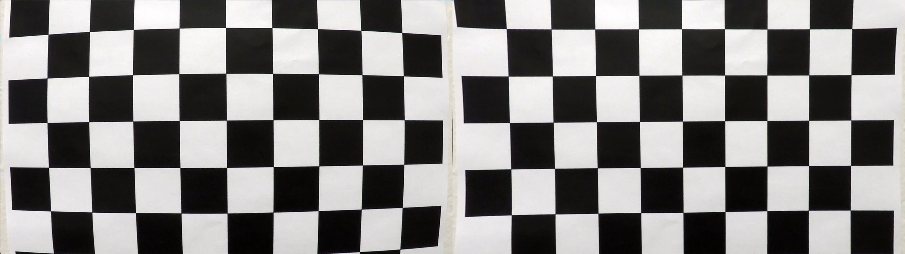
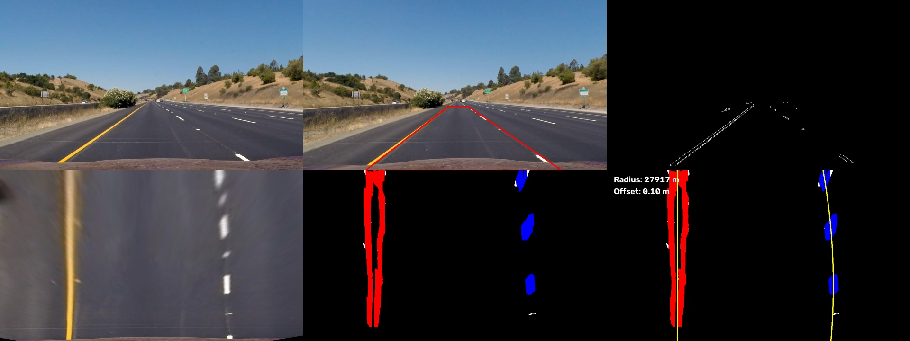
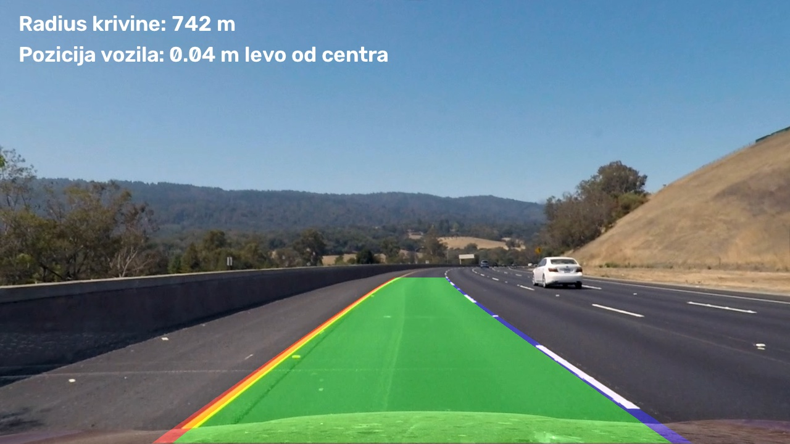
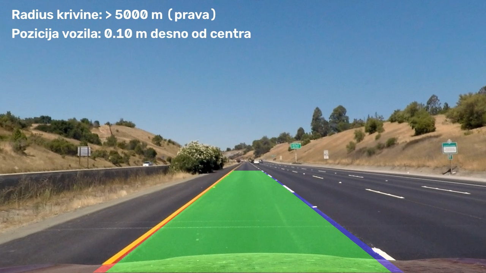
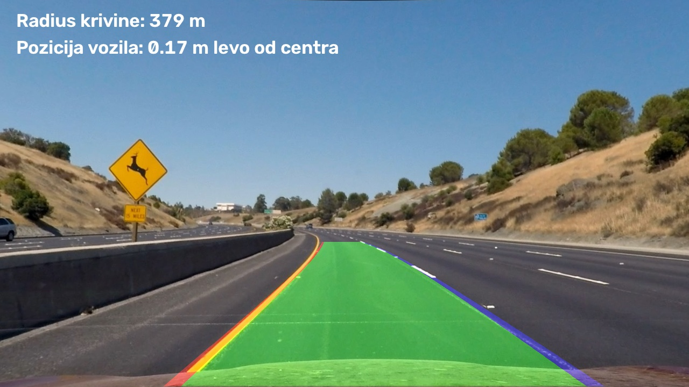

### Lane Finding Project

The goals / steps of this project are the following:

* Compute the camera calibration matrix and distortion coefficients given a set of chessboard images.
* Apply a distortion correction to raw images.
* Use color transforms, gradients, etc., to create a thresholded binary image.
* Apply a perspective transform to rectify binary image ("birds-eye view").
* Detect lane pixels and fit to find the lane boundary.
* Determine the curvature of the lane and vehicle position with respect to center.
* Warp the detected lane boundaries back onto the original image.
* Output visual display of the lane boundaries and numerical estimation of lane curvature and vehicle position.

### Overview

This project finds the lane lines on the road in single images and in a video, draws the lane back onto the original image, and estimates the radius of curvature of the road and the position of the vehicle in its lane. It is written in Python with OpenCV and NumPy, and the whole pipeline is in one file, `Zadatak/pipeline.py`. Every step of the pipeline is a separate function, and the function `process()` calls them one after another.

The pipeline for one image has these steps:

1. Camera calibration from chessboard images, and removing the lens distortion.
2. A binary image: yellow and white color masks, and Canny edge detection.
3. A perspective transform to a birds-eye view.
4. Hough line segments, and a second-order polynomial for each lane line.
5. Radius of curvature and vehicle position.
6. Drawing the lane back onto the road image.

For a video, the same pipeline is run on every frame, and the fits of the last five frames are averaged.

**Project structure.** This README and the folder `docs/` with the images are in the root of the repository. The project itself is in the folder `Zadatak/`.

**How to run it** (from the folder `Zadatak/`):

```powershell
python pipeline.py                                          # all images in test_images/
python pipeline.py test_images\test1.jpg                    # one image
python pipeline.py --video test_videos\project_video01.mp4  # video -> output_videos\
python pipeline.py --recalibrate                            # redo the calibration
```

---

### Writeup / README

#### 1. Provide a Writeup that includes all the rubric points and how you addressed each one.

You're reading it!

### Camera Calibration

#### 1. Briefly state how you computed the camera matrix and distortion coefficients. Provide an example of a distortion corrected calibration image.

The camera calibration is done in the function `calibrate()` in `pipeline.py`. I followed the method of the course example `09_01_calibration.py`.

A chessboard is a flat object with a known regular pattern, so I know where its inner corners are in the real world even though I don't know any real units. I describe the board with a grid of "object points" `(0,0,0), (1,0,0), (2,0,0) ... (8,5,0)`, one point per inner corner, in units of one square. The z coordinate is 0 because the board is flat. The same grid is used for every image, as if the board stayed fixed and the camera moved around it.

For every image `calibration*.jpg` in `camera_cal/` the function does the following:

1. It converts the image to grayscale and looks for the inner corners with `cv.findChessboardCorners`.
2. If the corners are found, it refines them to sub-pixel accuracy with `cv.cornerSubPix` (an 11x11 search window and a stop criterion of 30 iterations or 0.001 px change), as in the course example.
3. It saves the grid of object points and the detected image corners into two lists.

After all images are processed, the two lists are passed to `cv.calibrateCamera`, which returns the camera matrix `mtx` (focal lengths and the optical center), the distortion coefficients `dist` and the RMS reprojection error. `calibrate()` saves `mtx` and `dist` (together with the rotation and translation vectors) to `camera_cal/calib.npz`. The function `load_calibration()` loads this file, and runs the calibration only if the file does not exist (or if I start the program with `--recalibrate`). That way the calibration is done only once, and every later run uses the same numbers.

The course example expects a 9x6 board in every image. In my set of 20 images that is true for 17 images, but images 1, 4 and 5 are cropped so that some of the corners are outside of the picture. I solved this with a list of patterns, `CHESSBOARD_PATTERNS`: the function tries 9x6 first, and if it fails it tries smaller patterns. Images 1, 4 and 5 are found as 9x5, 6x5 and 7x6, so all 20 images are used. Each image has its own object-point grid with the right number of columns and rows. This is the one place where I changed the logic of the example, and I did it only so that no image is thrown away.


The result of the calibration, with all 20 images used:

| Quantity | Value |
|---|---|
| Focal lengths fx, fy | 1161.3, 1158.5 px |
| Optical center cx, cy | 666.7, 389.6 px |
| Distortion [k1, k2, p1, p2, k3] | -0.258, 0.062, -0.0002, -0.0001, -0.148 |
| RMS reprojection error | 0.996 px |

An RMS error of about 1 pixel on 1280x720 images means that the model reproduces the detected corners well. The large negative `k1` is the typical barrel distortion: straight lines bend outwards, and this is visible in the picture below.

To undistort an image I use `undistort()`, which follows `09_02_undistort.py`. It calls `cv.getOptimalNewCameraMatrix` and then `cv.undistort` with the new matrix. The only parameter I changed is `alpha`. The course example uses `alpha = 1`, which keeps all original pixels and leaves black borders around the corrected image. I use `alpha = 0`, which crops the image to the valid area, so there are no black borders. I chose it because I don't want black borders around the road image, and the perspective points that I use later were picked on the `alpha = 0` image.

Original (left) and distortion-corrected (right) calibration image:



### Pipeline (single images)

#### 1. Provide an example of a distortion-corrected image.

The first step for every road image is the function `undistort()`, which I described in the calibration section. In `process()` it is called right at the beginning, so everything that follows (colors, edges, perspective transform) works on an image without lens distortion. This matters for the perspective transform in particular, because it assumes that straight lines in the world are straight in the picture.

Before that, `main()` resizes every image to 1280x720, because the calibration matrix was computed for that image size. Some of the test images are 960x540, so they are enlarged first.

On a road image the correction is much less obvious than on the chessboard. A small difference can be seen near the edges of the picture, for example on the car hood at the bottom. The second window of the diagnostic image below shows the undistorted `straight_lines1.jpg` (the red trapezoid is the source region for the perspective transform, I use it in step 3). The first window shows the original image.



*In this image the top left window is the original and the top middle window is the undistorted image with the source trapezoid.*

#### 2. Describe how (and identify where in your code) you used color transforms, gradients or other methods to create a thresholded binary image.  Provide an example of a binary image result.

The binary image is made by the function `find_edges()` in `pipeline.py`. I combined color selection with edge detection. The course examples for this part were `06_01_color_masking.py` (color masks), `03_06_canny.py` (Gaussian blur and Canny) and `04_01_hough_lines.py` (the Canny thresholds).

**1. Color selection.** The image is converted from BGR to HSV with `cv.cvtColor`, because in HSV the color (hue) is separated from the brightness, which makes it easier to describe "yellow" and "white" paint. With `cv.inRange` I create two masks:

* yellow: H 15-35, S 80-255, V 90-255
* white: H 0-180, S 0-40, V 200-255 (any hue, but low saturation and high brightness)

The two masks are joined with `cv.bitwise_or`, and `cv.bitwise_and` keeps from the original image only the pixels that belong to the mask, as in the course example. The lower V limit of the yellow mask is 90, because the yellow line on `test5.jpg` is partly in shadow and is darker than the sun-lit paint.

**2. Edges.** The filtered image is converted to grayscale, blurred with a 5x5 Gaussian kernel to remove noise, and passed to `cv.Canny` with thresholds 100 and 170 (and `apertureSize = 3`). The color mask is applied first on purpose: Canny only sees the lane paint, and not the shadows, the asphalt texture and the cars.

**3. Region of interest.** `cv.fillPoly` makes a trapezoid in front of the car, with the corners `(100,720), (540,430), (760,430), (1200,720)`. Everything outside of it is set to zero with `cv.bitwise_and`, so the sky, trees and other cars on the sides are ignored.

The result is a black image with thin white outlines of the yellow and white lane paint. It is a binary image of edges and not a filled mask of the lane marking. I did not use a separate Sobel or Laplace gradient threshold from the course examples (`03_01` to `03_05`). Canny is the only gradient-based step, and the color masks do the rest of the work.

The third window of the diagnostic image below is the binary image for `straight_lines1.jpg`.


*The binary image is the top right window.*

The thresholds were chosen by looking at the test images, so they are not universal. Lane paint that is neither white nor yellow is not detected at all (see the Discussion).

#### 3. Describe how (and identify where in your code) you performed a perspective transform and provide an example of a transformed image.

The perspective transform is done by the function `warper(img, src, dst)` in `pipeline.py`. It is based on the function with the same name in the course example `examples/example.py`: it computes the transformation matrix with `cv.getPerspectiveTransform(src, dst)` and applies it with `cv.warpPerspective`. The goal is to look at the road from above ("birds-eye view"), so that the lane lines, which meet at the horizon in the camera picture, become parallel and vertical. That makes the later steps (Hough lines, fitting `x` as a function of `y`) much simpler.

The function needs four points in the original image (`SRC`) and four points where they should end up (`DST`). In the code they are constants at the top of `pipeline.py`:

| Point | Source (`SRC`) | Destination (`DST`) |
|---|---|---|
| top left | (611, 450) | (300, 0) |
| top right | (697, 450) | (980, 0) |
| bottom right | (1092, 720) | (980, 720) |
| bottom left | (260, 720) | (300, 720) |

I chose the source points on the undistorted pictures of the straight road (`straight_lines1.jpg` and `straight_lines2.jpg`). The trapezoid follows the two lane lines: the lower corners are on the lines at the bottom of the image, and the upper corners are on the same lines at the height of y = 450, a bit below the horizon. The destination points are a rectangle. The lines end up at x = 300 and x = 980, so the lane is 680 pixels wide in the birds-eye view, and I use this number later when I convert pixels to meters. I checked the result on the straight road: after the transform both lines have to be vertical and parallel. They are, as the bottom left window of the image below shows (the red trapezoid in the top middle window is `SRC`).


*The top middle window shows the source trapezoid on the undistorted image, and the bottom left window is the birds-eye view.*

Two differences compared to the course function:

* The course function always uses `cv.INTER_NEAREST`. My `warper()` has an extra parameter `flags` with the default `cv.INTER_LINEAR`, which gives smoother results for the color picture of the road.
* The warped edge image is not purely black and white anymore after the interpolation, because there are gray values on the edges of the lines. In `process()` I therefore threshold it again at 50 with `cv.threshold`, and I get a clean binary image for the Hough transform.

The same function is used again at the end, to draw the lane back on the road: I call `warper(layer, DST, SRC)` with the points swapped, which is the inverse transform.

#### 4. Describe how (and identify where in your code) you identified lane-line pixels and fit their positions with a polynomial?

Lane pixels are found in the functions `find_lane_points()`, `fit_line()` and `fit_lanes()` in `pipeline.py`. They work on the binary edge image after the perspective transform, so the lane lines are close to vertical. For finding the lines I used the Probabilistic Hough Transform from the course example `04_01_hough_lines.py`.

**Finding the line segments.** `cv.HoughLinesP` is called with `threshold = 30`, `minLineLength = 30` and `maxLineGap = 40`. These values differ from the course example (50, 200 and 10), because the lines in the birds-eye view are short, and the dashed lines on the right are broken into pieces. Before the call I set the left 80 pixels, the right 80 pixels and the bottom 60 pixels of the image to zero. The edges at the sides and the car hood at the bottom produce a lot of segments that have nothing to do with the lane.

**Deciding which segments belong to the lane.** Not every segment that the Hough transform returns is a lane line. Every segment goes through two tests:

1. It must be close to vertical. If its horizontal change is larger than 0.35 of its vertical change (about 19 degrees from vertical), I skip it. That removes edges of the guard rail, the bridge and other cars.
2. I extend the segment down to the bottom of the image and look at the x coordinate where it ends. If it is within 150 pixels of x = 300, it belongs to the left line, and if it is within 150 pixels of x = 980, it belongs to the right line. These are the destination x coordinates of the perspective transform. Segments that end somewhere else are neighboring lanes or other objects, and I skip them.

Each accepted segment is turned into points, about one point every two pixels along the segment. The longer segments therefore count more in the fit. One yellow line often gives two parallel segments, because Canny finds both edges of the painted stripe.

**Fitting the polynomial.** Each side is fitted separately in `fit_line()` with `np.polyfit`, a second-order polynomial for `x` as a function of `y`:

`x = A·y² + B·y + C`

I use `x(y)` and not `y(x)`, because the lines are almost vertical. A side is fitted only if it has at least 10 points that cover at least 30% of the image height, otherwise a short piece of a line could produce an unreliable curve. After the first fit I remove the points that are more than 50 pixels away from the curve and fit again with the remaining points.

If one side cannot be fitted (for example, a dashed line with long gaps), `fit_lanes()` makes it from the other side: the same polynomial, shifted by 680 pixels (the lane width in the birds-eye view). If neither side can be fitted, the frame has no lane. In the fit image the curves that were really found are yellow, and a copied curve would be magenta.

Hough segments (red = left line, blue = right line) and the fitted curves, for `straight_lines1.jpg`:


*The bottom middle window shows the Hough segments and the bottom right window shows the fitted curves.*

This method is simple, but it has a weakness: every side has its own polynomial, and if only a short part of a line is visible, the curve can bend strongly outside of that part. I describe the cases where this happened in the Discussion.

#### 5. Describe how (and identify where in your code) you calculated the radius of curvature of the lane and the position of the vehicle with respect to center.

The radius of curvature and the position of the vehicle are calculated by the function `measure()` in `pipeline.py`. It gets the two fitted polynomials (in pixels, in the birds-eye view) and the size of the image.

**Pixels to meters.** The polynomials are in pixels, but the radius should be in meters. I use two conversion constants:

* `YM_PER_PIX = 30 / 720`: I assume that the birds-eye view shows about 30 meters of road along its 720 pixel height.
* `XM_PER_PIX = 3.7 / 680`: a lane is about 3.7 meters wide, and in the birds-eye view it is 680 pixels wide (the distance between the destination points of the perspective transform).

These two values are assumptions, not measurements. I did not measure the real road or the camera, so the numbers in meters are only approximate.

**Radius of curvature.** For each of the two lines I take the points of the fitted polynomial for every row `y` of the image, multiply them by the constants above, and fit a new second-order polynomial `x = A·y² + B·y + C` in meters. The radius of curvature of such a curve at the height `y` is

`R = (1 + (2·A·y + B)²)^(3/2) / |2·A|`

I evaluate it at the bottom of the image, `y = 720 · YM_PER_PIX` (30 m), because that is the part of the road that is closest to the car. The result for the lane is the average of the left and the right radius. A line that is almost straight has `A` close to zero, so its radius is very large. I limit the denominator to a small positive number so that the program never divides by zero. On the result image a radius larger than 5000 m is written as "> 5000 m (prava)", which means a straight road.

**Position of the vehicle.** I assume that the camera is in the middle of the car, so the center of the car is in the middle of the image, at `x = width / 2 = 640`. The center of the lane is the average of the left and the right line at the bottom row of the image. The offset in meters is

`offset = (width / 2 - lane_center) · XM_PER_PIX`

A negative value means that the center of the car is to the left of the lane center, and a positive value means it is to the right. The function also returns the distance between the two lines at the bottom row in pixels. I use it as a check: it should be close to 680 pixels.

The results for the test images (`python pipeline.py`):

| Image | Radius [m] | Offset [m] | Lane width [px] |
|---|---|---|---|
| challange00101 | 418 | -0.25 | 634 |
| challange00111 | 328 | -0.11 | 741 |
| challange00136 | 278 | -0.03 | 711 |
| solidWhiteCurve | 2526 | -0.21 | 717 |
| solidWhiteRight | 14470 | 0.02 | 707 |
| solidYellowCurve | 1150 | -0.08 | 694 |
| solidYellowCurve2 | 1095 | -0.31 | 805 |
| solidYellowLeft | 556 | -0.13 | 776 |
| straight_lines1 | 27917 | 0.10 | 648 |
| straight_lines2 | 2918 | 0.11 | 701 |
| test1 | 226 | -0.13 | 567 |
| test2 | 379 | -0.17 | 647 |
| test3 | 742 | -0.04 | 693 |
| test4 | 535 | -0.10 | 605 |
| test5 | 787 | 0.15 | 766 |
| test6 | 4760 | -0.09 | 734 |
| whiteCarLaneSwitch | 854 | -0.16 | 668 |

These numbers are estimates, and I would not trust them as measurements:

* On the two straight road images the radius is very large (27917 m and 2918 m), and it changes a lot between them. On an almost straight road a tiny error in the fit changes the radius by a large factor.
* The measured lane width is between 567 and 805 pixels instead of 680. So the perspective points and my assumption for the lane width are only approximate. The smallest widths are on `test1` (567 px) and `test4` (605 px), and these two images also have the smallest radii (226 m and 535 m), so I think these two radii are too small.
* The images `solid*`, `challange*` and `whiteCarLaneSwitch` are 960x540. I enlarge them to 1280x720, but I do not know if they come from the same camera as the calibration images (not verified), so for these images I would not trust either the radius or the offset.

#### 6. Provide an example image of your result plotted back down onto the road such that the lane area is identified clearly.

The lane is drawn back onto the road by the function `draw_lane()` in `pipeline.py`. It does this in four steps:

1. It takes the two fitted polynomials and calculates the x coordinate of each curve for every row of the image.
2. On an empty black image of the same size, in the birds-eye view, it fills the area between the two curves with `cv.fillPoly` (green) and draws the two lines with `cv.polylines` (red for the left and blue for the right line, 25 pixels thick).
3. It transforms this layer back to the camera's point of view with the same function `warper()`, but with the points swapped, `warper(layer, DST, SRC)`. This is the inverse of the perspective transform from step 3.
4. It blends the layer with the undistorted road image using `cv.addWeighted` (the course example `03_01_sobel.py` uses this function to combine two images), with the weights 1.0 for the road and 0.4 for the layer, so the road stays visible under the green area.

At the end `cv.putText` writes the radius of curvature and the position of the vehicle in the corner of the image. The text on the image is in Serbian: "Radius krivine" is the radius of curvature, "Pozicija vozila ... od centra" is the position of the vehicle from the center, and "levo" / "desno" mean left / right. A radius larger than 5000 m is written as "> 5000 m (prava)", which means a straight road.

Results for three test images (`test3.jpg`, `straight_lines1.jpg` and `test2.jpg`):







In all three images the green area is between the two lane lines, and the red and blue lines cover the yellow and the white line. The script saves a result image like this for every test image into the folder `examples/` as `<image_name>_result.jpg`.

### Pipeline (video)

#### 1. Provide a link to your final video output.  Your pipeline should perform reasonably well on the entire project video (wobbly lines are ok but no catastrophic failures that would cause the car to drive off the road!).

The video is processed by the function `process_video()` in `pipeline.py`. It reads the video frame by frame with `cv.VideoCapture`, as in the course example `06_01_color_masking.py`, resizes every frame to 1280x720, runs the same `process()` function that I use for single images, and writes the result with `cv.VideoWriter` (codec `mp4v`, the same frame rate as the input video).

The lane in a single frame can jump from frame to frame, because the fit depends on which Hough segments are found in that frame. In a video I therefore added two things in `process()`:

* **Averaging.** The program keeps the last five accepted pairs of polynomials and uses their average for drawing and for the measurements.
* **Checking the new fit.** A new fit is accepted only if the distance between its two lines stays between 450 and 950 pixels in all rows of the image (the very first fit is always accepted). If a frame gives no usable fit, the program uses the average of the previous fits and does not skip the frame.

The program prints the number of processed frames and the number of frames without a lane at the end. Both videos were processed completely:

| Input video | Frames | Frames without a lane | Output |
|---|---|---|---|
| `project_video01.mp4` | 221 | 0 | [project_video01_out.mp4](./Zadatak/output_videos/project_video01_out.mp4) |
| `project_video02.mp4` | 681 | 0 | [project_video02_out.mp4](./Zadatak/output_videos/project_video02_out.mp4) |


### Discussion

#### 1. Briefly discuss any problems / issues you faced in your implementation of this project.  Where will your pipeline likely fail?  What could you do to make it more robust?

**Problems I had.**

* **Bridge and guard rail edges.** On `test1.jpg`, `test4.jpg` and `test5.jpg` their Hough segments pulled the polynomial away from the lane. The two tests in `find_lane_points()` (almost vertical, and ending near the expected x at the bottom) fixed most of it. It is not perfect: on `test1.jpg` and `test4.jpg` the left curve still bends strongly in the upper part, so their radiius (226 m and 535 m) are probably too small.
* **Yellow line in shadow.** On `test5.jpg` it was missed until I lowered the minimum V of the yellow mask to 90.
* **Black borders after undistorting.** The course example uses `alpha = 1`; I switched to `alpha = 0` and chose the perspective points for that image.
* **Jumping lane in the video.** A single fit jumped between frames, so I added averaging of the last five fits and the check of the lane width.

**Where the pipeline will likely fail.**

* **Lane paint that is not white or yellow.** The binary image comes only from the color masks. On the course video `examples/example.mp4`, where the lines are red, the lane was not found in most frames.
* **Short or partly visible lines.** Each side has its own polynomial, so it can bend strongly outside of the visible piece.


